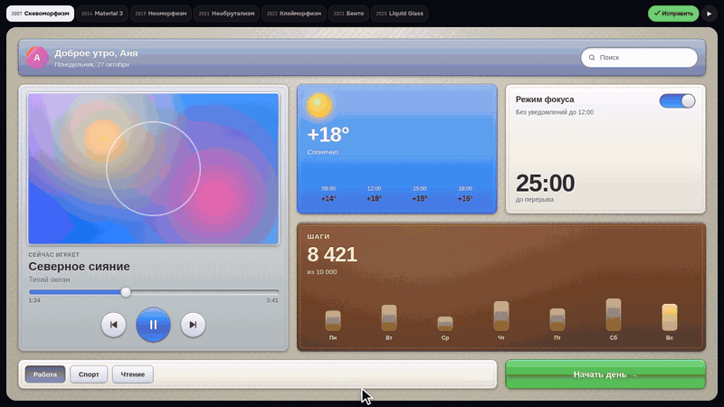
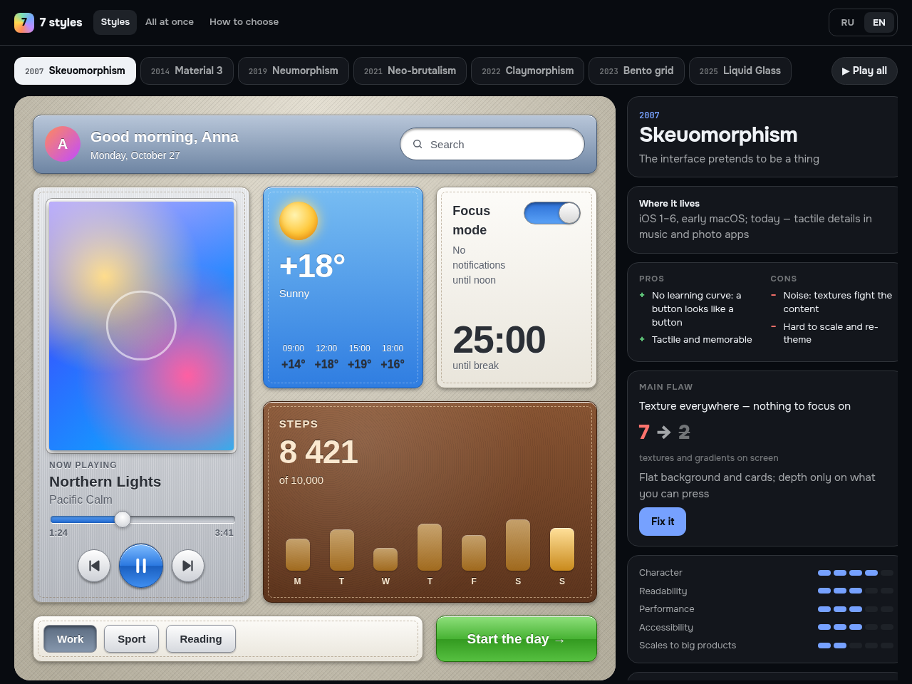
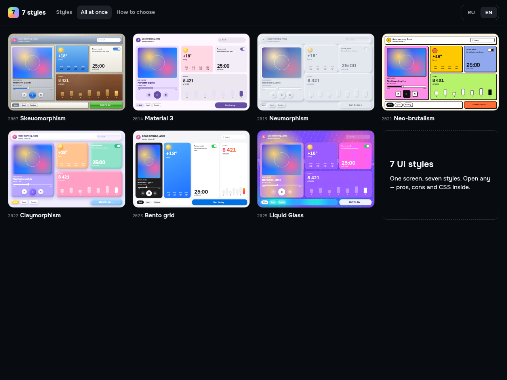
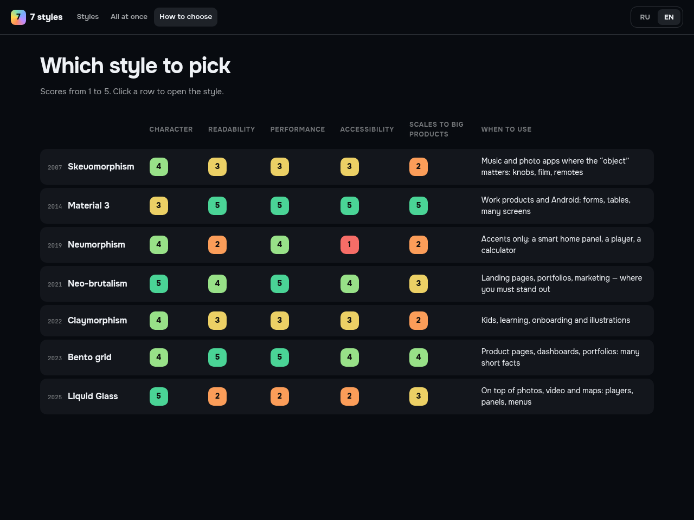

# 7 UI styles · 7 стилей интерфейса

One screen in seven UI styles — skeuomorphism, Material 3, neumorphism, neo-brutalism, claymorphism, bento grid and Apple's Liquid Glass. For each style: how it's built in CSS, where it lives, pros and cons, and **its main flaw with a measured fix**.

**▶ Live:** https://arthurkrantsevich.github.io/ui-styles/ · **Video (RU + EN audio):** VIDEO_URL



| Style | Year | Main flaw | Fix | Before → after |
|---|---|---|---|---|
| Skeuomorphism | 2007 | Texture everywhere | Depth only on what you can press | 7 → 2 textures |
| Material 3 | 2014 | Looks like every Google app | Own seed color + Expressive shape morph | 1 → 2 button shapes |
| Neumorphism | 2019 | Button edge is a 1.5:1 shadow | 1px border, accent on the main action | 1.5:1 → 3.6:1 |
| Neo-brutalism | 2021 | Five bright colors fight | One bright color, on the main action | 5 → 1 colors |
| Claymorphism | 2022 | White text on pastel | Dark text of the same hue | 1.7:1 → 7.1:1 |
| Bento grid | 2023 | Equal tiles = collage | One hero tile, 4× larger | 1× → 4× |
| Liquid Glass | 2025 | White text over a bright spot | Denser tint + `prefers-reduced-transparency` | 1.3:1 → 16:1 |

Contrast values are WCAG 2.x ratios computed from the actual colors in `src/app.css`.



### What's inside

- **Styles** — the same React screen; only `data-style` changes. Switching uses the View Transitions API, so widgets morph into the new style.
- **Fix it** — every style has a `data-fix` variant that removes its main flaw.
- **Liquid Glass** — real refraction: a per-widget displacement map (canvas → SVG `feDisplacementMap`) used in `backdrop-filter: url(#…)`. Chromium only; other browsers fall back to frosted glass.
- **All at once** and **How to choose** — all seven side by side and a score matrix with when to use each.
- **RU / EN** — follows the browser language, remembers your choice, `?lang=en` forces it.




### Run

```bash
npm install
npm run dev     # http://localhost:5195
npm run build
```

Vite + React 19 + TypeScript, no UI libraries. MIT.

---

## По-русски

Один экран в семи стилях интерфейса: скевоморфизм, Material 3, неоморфизм, необрутализм, клейморфизм, бенто и Liquid Glass. Для каждого — как он строится в CSS, где живёт, плюсы и минусы и **главный минус с исправлением в цифрах** (таблица выше: контраст посчитан по формуле WCAG из настоящих цветов).

- **Стили** — один и тот же React-экран, меняется только `data-style`; при переключении виджеты перетекают в новый стиль (View Transitions API).
- **Исправить** — у каждого стиля есть вариант `data-fix` без главного минуса.
- **Liquid Glass** — настоящее преломление: карта смещения для каждого виджета и `backdrop-filter: url(#…)`. Работает в Chrome, в остальных браузерах — матовое стекло.
- **Все сразу** и **Как выбрать** — все семь рядом и матрица оценок с подсказкой, когда какой брать.
- **RU / EN** — язык браузера по умолчанию, выбор запоминается.

Видео с разбором (русская и английская дорожки): VIDEO_URL · канал [@NeuroP1lot](https://www.youtube.com/@NeuroP1lot)
